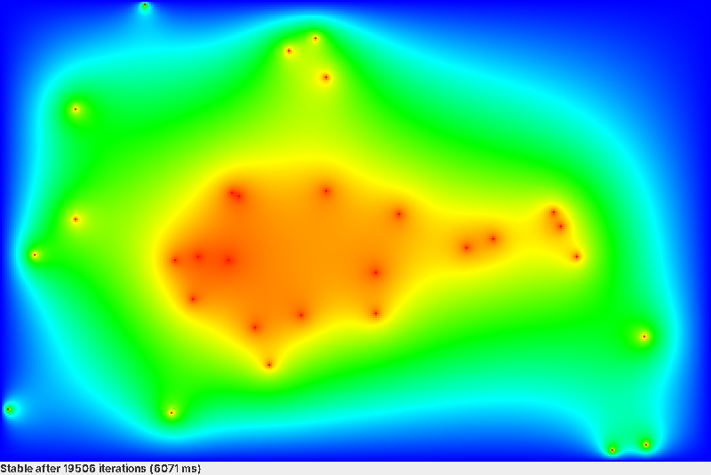

<p align="center">
  
  
  
  
  
  
</p>

# 🔥 2D Heat Distribution Simulation

Steady-state heat distribution on a metal plate, solved three ways – **sequential**, **parallel** (threads) and **distributed** (Java RMI) – with a live Swing visualization and a benchmark that checks all three produce the same result.

Built for the **Programming III** course.

> **Status:** finished. `v1.0.0` is the final release and the project is no longer under active development.

<p align="center"></p>

## Model

- The plate is a `width × height` grid.
- Edges are held at **0 °C**; `points` random interior cells are heat sources held at **100 °C**. Everything else starts at 0 °C.
- Each iteration replaces every free cell with the average of its four neighbours (Jacobi relaxation).
- The run stops when the largest change in one iteration drops below the threshold (default **0.25 °C**).
- Sources are placed from a seed, so a given `--seed` always produces the same plate.

## Execution modes

| Mode          | How it works |
|---------------|--------------|
| `sequential`  | One thread sweeps the whole grid. Reference implementation. |
| `parallel`    | Interior rows are split into one band per thread; a fixed thread pool relaxes the bands each iteration and the largest change is reduced across threads. |
| `distributed` | The master splits rows into one band per worker and sends each band **with its halo rows** to a worker over **Java RMI**, then gathers the results. Workers run either in-process behind a private RMI registry (`--workers N`) or as separate JVMs, possibly on other machines (`--hosts`). |

All three use the same kernel and produce **bit-identical** plates; the benchmark and the tests check this.

## Running

Requires Java 17+. Download `heat-sim-1.0.0.jar` from the [latest release](../../releases/latest), or build it:

```bash
mvn package
```

```bash
java -jar target/heat-sim-1.0.0.jar sequential --width 400 --height 300 --points 30
java -jar target/heat-sim-1.0.0.jar parallel --width 400 --height 300 --points 30 --threads 8 --gui
java -jar target/heat-sim-1.0.0.jar distributed --width 400 --height 300 --points 30 --workers 4
```

`--gui` opens a window that updates while the simulation runs (blue = 0 °C, red = 100 °C). For a smoother final picture use a tighter threshold, e.g. `--threshold 0.001`.

### Distributed across JVMs or machines

Start a worker in each terminal or machine:

```bash
java -jar heat-sim-1.0.0.jar worker --port 1099
java -jar heat-sim-1.0.0.jar worker --port 1100
```

Then run the master against them:

```bash
java -jar heat-sim-1.0.0.jar distributed --hosts localhost:1099,localhost:1100 --width 400 --height 300 --points 30
```

For workers on other machines, start each one with `-Djava.rmi.server.hostname=<its reachable IP>` and open its registry port plus RMI's dynamic ports in the firewall.

### All options

```
--width N        grid width               (default 200)
--height N       grid height              (default 200)
--points N       number of heat sources   (default 20)
--seed N         random seed              (default 42)
--threshold T    stop when max change < T (default 0.25)
--max-iter N     iteration limit          (default 1000000)
--threads N      parallel threads         (default: CPU cores)
--workers N      local RMI workers        (default: CPU cores)
--hosts h:p,...  remote RMI workers instead of local ones
--port N         worker registry port     (default 1099)
--gui            show the plate while it is simulated
```

## Benchmark

```bash
java -jar heat-sim-1.0.0.jar benchmark --sizes 200,400,800 --points 40 --threshold 0.01 --runs 3 --csv results.csv
```

For each size this times every mode (best of `--runs`), prints the speed-up over sequential, and confirms each mode's final plate matches the sequential one exactly. It exits non-zero if any mode disagrees.

What to expect:

- **Parallel** gains grow with grid size and core count; small grids are dominated by per-iteration synchronisation.
- **Distributed** on a single machine is much slower than sequential, because every iteration serialises each band over RMI. It demonstrates the message-passing design (band decomposition, halo exchange, gather and reduce) rather than single-machine speed; it only pays off when the per-band work outweighs the network cost.

## Project structure

```
src/main/java/heatsim/
  Grid.java               plate, fixed cells, double buffer
  Kernel.java             Jacobi step and row-band partitioning
  Simulation.java         convergence loop
  SequentialSolver.java
  ParallelSolver.java
  DistributedSolver.java  RMI master, local cluster, standalone worker
  Worker.java, WorkerImpl.java
  HeatView.java           Swing visualization
  Benchmark.java
  Main.java               command-line interface
src/test/java/heatsim/    equivalence and invariant tests
```

The original course-submission code, including earlier iterations, is preserved at tag [`v0.1.0`](../../tree/v0.1.0).

## Author

Anastasija Temova – [atemova.github.io](https://atemova.github.io)

## License

[MIT](LICENSE)
